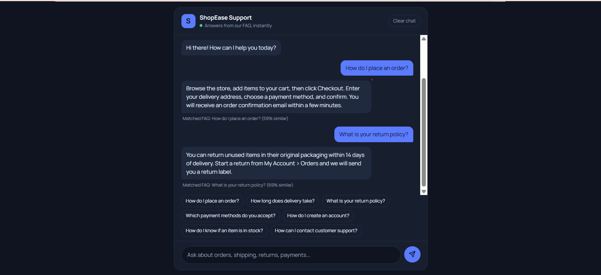

# FAQ Chatbot
   

A chatbot that answers customer questions by matching them to the most similar FAQ.
Built for the CodeAlpha internship (Task: FAQ Chatbot). The sample topic is **ShopEase**, a fictional online store; swap `faqs.json` to use any other topic or product.

## How it works

1. **Collect FAQs** - `faqs.json` holds 20 FAQs (category, question, keywords, answer).
2. **Preprocess (NLTK)** - lowercase, tokenize, remove punctuation and stop words, lemmatize ("returns" -> "return", "shipping" -> "ship").
3. **Vectorize** - each FAQ becomes a TF-IDF vector (unigrams and bigrams) using scikit-learn.
4. **Match** - the user's message is vectorized the same way and compared with every FAQ using **cosine similarity**.
5. **Respond** - if the best score is at least `0.20`, the bot shows that FAQ's answer. Otherwise it shows a fallback with up to 3 "did you mean" suggestions.
6. **Chat UI** - a responsive web interface (HTML, CSS, JavaScript) served by Flask.

Greetings, thanks, and goodbyes are handled by a small rule-based intent matcher.

## Project structure

```
faq-chatbot/
|-- app.py            Flask server and API routes
|-- chatbot.py        NLP engine (preprocessing, TF-IDF, cosine similarity)
|-- faqs.json         FAQ dataset
|-- index.html        Chat page
|-- style.css         Styling (light and dark mode)
|-- script.js         Front-end logic
|-- requirements.txt  Python dependencies
`-- README.md
```

## Setup

```bash
python -m venv venv
venv\Scripts\activate          # Windows
# source venv/bin/activate     # macOS / Linux
pip install -r requirements.txt
python app.py
```

Open http://127.0.0.1:5000 in your browser. NLTK data (stopwords, WordNet) downloads automatically on first run.

To chat in the terminal instead: `python chatbot.py`

## API

| Method | Route              | Description                                   |
|--------|--------------------|-----------------------------------------------|
| POST   | `/api/chat`        | Body `{"message": "..."}`, returns the answer |
| GET    | `/api/suggestions` | Returns starter questions for the UI          |

Example response:

```json
{
  "type": "answer",
  "answer": "Standard delivery takes 3 to 5 working days...",
  "matched_question": "How long does delivery take?",
  "category": "Shipping",
  "confidence": 0.71
}
```

## Customising

- **New topic:** replace the entries in `faqs.json` (keep the same fields) and update the brand text in `index.html` and `chatbot.py`.
- **Strictness:** change `CONFIDENCE_THRESHOLD` in `chatbot.py`. Higher means fewer but more certain answers.
- **Better matching:** add more words to an FAQ's `keywords` field.

## Tech stack

Python, Flask, NLTK, scikit-learn, HTML, CSS, JavaScript
